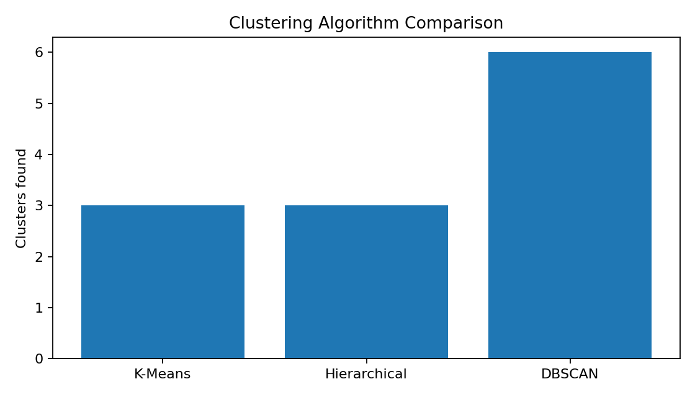
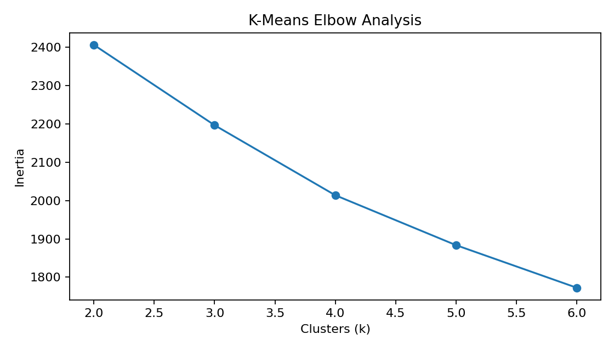
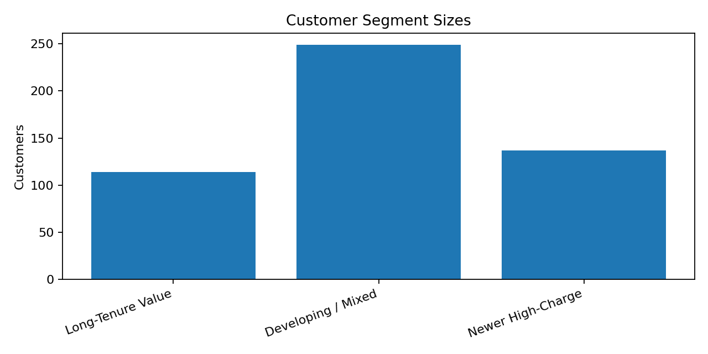
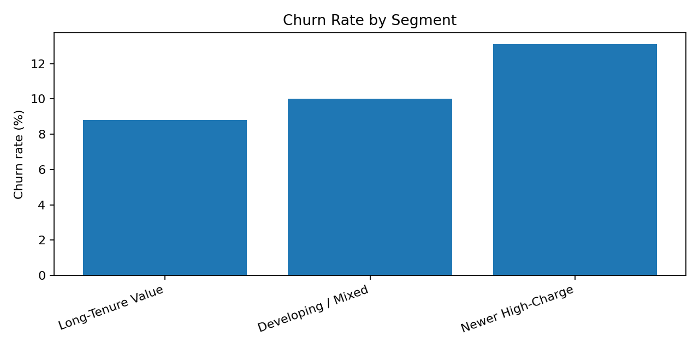

<div align="center">

# 📊 Customer Segmentation & Prediction

### Week 11 | Developer's Arena

**Machine Learning • Customer Analytics • Churn Prediction**

<p>
  <b>Developed by Hariesh Saravanan</b>
</p>

<p>
  
  
  
  
</p>

</div>

---

## 📌 Project Overview

This project explores customer segmentation and churn prediction using machine learning. It compares three clustering algorithms and builds segment-specific Random Forest classifiers to understand customer behavior and identify potential churn risks.

The workflow includes data validation, preprocessing, clustering evaluation, hyperparameter tuning, model evaluation, visualizations, and actionable business recommendations.

## 🎯 Objectives

- Segment customers into meaningful behavioral groups.
- Compare K-Means, Agglomerative Clustering, and DBSCAN.
- Develop churn prediction models for each K-Means segment.
- Tune Random Forest hyperparameters using GridSearchCV.
- Evaluate models using appropriate classification metrics.
- Translate analytical findings into practical business recommendations.

## 🗂️ Dataset Information

The supplied dataset contains **500 rows and 9 columns**.

| Column | Description |
|---|---|
| `CustomerID` | Customer identifier, excluded from model features |
| `Tenure` | Customer tenure |
| `MonthlyCharges` | Monthly customer charges |
| `TotalCharges` | Total customer charges |
| `Contract` | Customer contract type |
| `PaymentMethod` | Customer payment method |
| `PaperlessBilling` | Paperless billing status |
| `SeniorCitizen` | Senior citizen indicator |
| `Churn` | Binary churn target |

**Note:** The supplied dataset contains nine columns, although the original task brief mentions four.

## 🛠️ Technologies Used

- Python
- Pandas and NumPy
- Matplotlib and Seaborn
- Scikit-learn
- Jupyter Notebook
- Random Forest Classification
- K-Means, Agglomerative Clustering, and DBSCAN
- GridSearchCV for hyperparameter tuning

## ⚙️ Project Workflow

1. **Data validation:** Check dimensions, missing values, duplicates, and target distribution.
2. **Preprocessing:** Prepare numerical and categorical variables for machine learning.
3. **Clustering:** Compare three clustering algorithms and examine suitable cluster configurations.
4. **Segmentation:** Create three K-Means customer segments for downstream prediction.
5. **Model training:** Train segment-specific Random Forest churn classifiers.
6. **Hyperparameter tuning:** Use GridSearchCV where segment sample sizes permit.
7. **Evaluation:** Measure accuracy, precision, recall, F1-score, and ROC-AUC when valid.
8. **Business interpretation:** Develop customer retention recommendations based on segment profiles.

## 📈 Visualizations

The project includes analysis charts covering clustering quality, segment sizes, and churn patterns.

<div align="center">

### Clustering Algorithm Comparison



### Elbow Method



### Customer Segment Sizes



### Churn Rate by Segment



</div>

> If a chart does not appear, check that the image exists at the specified path inside the `WEEK 11` folder. GitHub displays images using paths relative to the README file.

## 📁 Repository Structure

```text
WEEK 11/
├── README.md
├── DATASET_NOTES.md
├── TESTING_AND_VALIDATION.md
├── requirements.txt
├── customer_segmentation.ipynb
├── segmentation_data.csv
├── segment_profiles.csv
├── segment_profiles.md
├── model_evaluation_results.csv
├── business_recommendations.pdf
├── clustering_comparison.png
├── elbow_method.png
├── segment_sizes.png
├── segment_churn_rates.png
├── screenshots/
└── VISUALIZATIONS/
```

## 🚀 Installation and Execution

### 1. Install Python

Install Python 3.10 or later.

### 2. Navigate to the project directory

```bash
cd "WEEK 11"
```

### 3. Create a virtual environment (optional)

```bash
python -m venv .venv
```

Activate it on Windows:

```bash
.venv\Scripts\activate
```

On macOS/Linux:

```bash
source .venv/bin/activate
```

### 4. Install dependencies

```bash
pip install -r requirements.txt
```

### 5. Launch Jupyter Notebook

```bash
jupyter notebook
```

Open `customer_segmentation.ipynb` and run the cells in sequence.

## 📊 Model Evaluation

The project evaluates the models using:

| Metric | Purpose |
|---|---|
| Accuracy | Overall proportion of correct predictions |
| Precision | Proportion of predicted churn cases that are actual churn cases |
| Recall | Proportion of actual churn cases correctly identified |
| F1-score | Balance between precision and recall |
| ROC-AUC | Ability to rank churn and non-churn cases when both classes are available |

GridSearchCV tunes Random Forest parameters, including estimator count, maximum depth, and minimum leaf size, when the available data supports the search.

## 💡 Business Recommendations

The analysis supports investigating retention strategies tailored to customer segments, such as:

- Reviewing contract and payment patterns associated with churn.
- Improving onboarding and engagement for newer customers.
- Testing targeted retention offers for higher-risk customers.
- Monitoring segment-level churn and customer value.
- Running controlled experiments to measure whether interventions improve retention.

See [`business_recommendations.pdf`](business_recommendations.pdf) for the detailed business interpretation.

## ⚠️ Limitations

- Small segment test sets may produce unstable evaluation metrics.
- ROC-AUC cannot be calculated reliably when the test set contains only one class.
- DBSCAN results depend on parameter choices and may classify some customers as noise.
- High accuracy alone does not guarantee effective churn detection.
- Business impact has not been established through controlled experiments.
- Customer segments describe patterns in the supplied dataset and should not automatically be treated as causal explanations.

## 🔍 Reproducibility and Validation

The project includes validation checks, documented dependencies, a Jupyter Notebook workflow, model evaluation results, and supporting analysis files.

Review [`DATASET_NOTES.md`](DATASET_NOTES.md) and [`TESTING_AND_VALIDATION.md`](TESTING_AND_VALIDATION.md) for additional details.

## 👨‍💻 Author

**Hariesh Saravanan**

B.Tech Artificial Intelligence and Data Science

- GitHub: [HARIESHSARAVANAN](https://github.com/HARIESHSARAVANAN)
- Repository: [DEVELOPER-S-ARENA-](https://github.com/HARIESHSARAVANAN/DEVELOPER-S-ARENA-)

---

<div align="center">

**⭐ Week 11 | Customer Segmentation & Prediction**

*Turning customer data into meaningful insights and informed decisions.*

</div>
